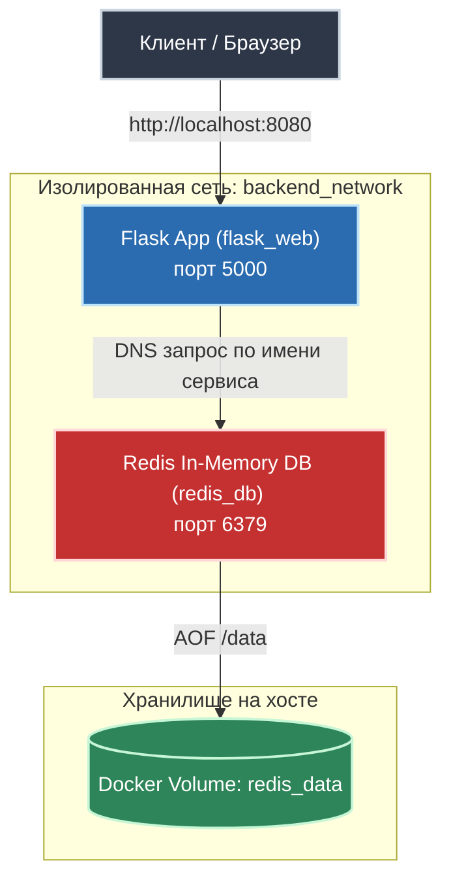

**Лабораторный проект по оркестрации многоконтейнерного веб-приложения с использованием Docker Compose, изолированной сети bridge, персистентного хранилища данных (Docker Volumes) и конфигурации окружения через `.env`.**

# Архитектура стека

# Компоненты стека

1.  `web` (Python/flask):
		- Обрабатывает HTTP-запросы на внутреннем порту `5000`.
		- При каждом обращении инкрементирует значение счетчика посещений в Redis.
		- Слушает все сетевые интерфейсы ( `host='0.0.0.0'`).

2.  `redis_storage` (Redis:alpine):
		- Работает в режиме in-memory key-value базы.
		- Запущен с флагом `--appendonly yes` (AOF - сброс лога операций на диск).

3. `backend_network`:
		- Изолированная сеть драйвера `bridge`. Позволяет контейнерам находить друг друга по именам сервисов (`redis_storage`) через встроенный DNS-сервер DOCKER без хардкора IP-адресов.

4.  `redis_data`:
		- Именованный Docker Volume, монтируемый в /data контейнера Redis. Гарантирует сохранение данных даже при полном удалении контейнеров (`docker compose down`).

# Структура проекта

lab-02/
├── app.py                # Исходный код приложения Flask
├── Dockerfile            # Инструкция сборки образа веб-приложения
├── docker-compose.yml    # Описание многоконтейнерного стека
├── .env.example          # Пример файла переменных окружения
└── README.md             # Документация проекта

# Конфигурация (.env)

Переменные окружения внесены в файл `.env`:

	`APP_PORT=8080`
	`REDIS_HOST=redis_storage`
	`REDIS_PORT=6379`

==🔴Важно==: Файл `.env` должен быть добавлен в `.gitignore`, чтобы секреты и боевые конфиги не попадали в систему контроля версий. Для примера в репозитории хранится `.env.example`.

# Быстрый запуск

1. Клонирование и подготовка
		`cp .env.example .env`

2. Запуск стека
		`docker compose up -d --build`

3. Проверка статуса контейнеров
		`docker compose ps`

4. Проверка работы сервиса
		curl http://localhost:8080
		# Ответ: Hello! This page has been viewed X times.

# Проверка персистентности данных (Crash-test)

1. Открыть `http://localhost:8080` и набить счётчик просмотров (например, до 5).

2. Полностью остановить и удалить контейнеры:
		`docker compose down`

3. Поднять стек заново:
		`docker compose up -d`

4. Обновить страницу в браузере. Счётчик продолжит инкремент со следующего значения (6), что подтверждает корректную работу монтирования тома `redis_data`.

# Инженерные выводы и решённые проблемы (Troubleshooting)

- **Конфликт сокета `address already in use (8080)`:** Порт удерживался фоновой службой хоста (`nginx.service`). Решено остановкой и маскированием демона через `systemctl mask nginx`, чтобы предотвратить его автозапуск. После освобождения сокета контейнеры пересозданы с флагом `--force-recreate`.

- **DNS и маршрутизация пакетов в ядре (`nftables`):** Столкнулись с блокировкой внешнего DNS-трафика при сборке образа (`pip install failure`) из-за глобальной политики `drop` в цепочке `forward` файрвола хоста. Решено разрешением транзитной маршрутизации трафика для Docker-интерфейсов (`ip_forward` и правила forward в `nftables`).

- **Привязка хоста во Flask:** В контейнеризованном приложении недопустимо запускать сервер на `127.0.0.1`. Flask обязан слушать `0.0.0.0`, иначе прокси Docker не сможет пробросить входящие пакеты внутрь контейнера.

